# PC Case Internal Wiring Guide
## Motherboard Internal USB Header + CH340 Module + Custom Stripboard Rev 1.1a (High-Side Sziklai Control)

Este documento detalha o cabeamento interno no gabinete do computador (chassis ATX/Micro-ATX), interligando a placa-mãe (header USB 2.0 interno de 9 pinos), a fonte de alimentação do PC (conector MOLEX ATX padrão de 4 pinos com +12V e +5V), o conversor USB-Serial CH340 e a controladora **Custom Stripboard Rev 1.1 / Rev 1.1a** com **Controle High-Side por Par Sziklai (BC549 + BC328)** e conexão direta das ventoinhas via **Conectores PC Fan de 3 Pinos (`FAN1`..`FAN4`)**.

---

## 1. Diagrama Geral de Interconexão (System Interconnect)

```mermaid
flowchart TD
    subgraph PSU ["Fonte do PC (Conector MOLEX ATX 4-Pinos)"]
        PSU_12V["Pino 1: Fio Amarelo (+12V DC)"]
        PSU_GND1["Pino 2: Fio Preto (GND)"]
        PSU_GND2["Pino 3: Fio Preto (GND)"]
        PSU_5V["Pino 4: Fio Vermelho (+5V DC)"]
    end

    subgraph MOTHERBOARD ["Placa-Mãe (Header USB 2.0 Interno - 9 Pinos)"]
        MB_5V["Pino 1: +5V (VBUS)"]
        MB_DM["Pino 3: USB Data Minus (D-)"]
        MB_DP["Pino 5: USB Data Plus (D+)"]
        MB_GND["Pino 7: Ground (GND)"]
    end

    subgraph CH340_MOD ["Módulo CH340 (Barra de 6 Pinos Fêmea / Macho)"]
        DTR_PIN["Pino 1: DTR"]
        RXD_PIN["Pino 2: RXD"]
        TXD_PIN["Pino 3: TXD"]
        VCC_PIN["Pino 4: VCC (+5V)"]
        CTS_PIN["Pino 5: CTS (NC)"]
        GND_PIN["Pino 6: GND"]
    end

    subgraph STRIPBOARD ["Custom Stripboard Rev 1.1a (Eurocard 88.9x128.3 mm)"]
        subgraph MOLEX_IN ["Conector de Entrada MOLEX ATX Onboard"]
            MOLEX_P1["Pino 1: +12V"]
            MOLEX_P2["Pino 2: GND"]
            MOLEX_P3["Pino 3: GND"]
            MOLEX_P4["Pino 4: +5V"]
        end

        subgraph MCU ["Núcleo Lógico ATmega328P-PU (16 MHz)"]
            MCU_RST["Pino 1: /RESET (via 100nF DTR-Cap + 10k Pull-up)"]
            MCU_RXD["Pino 2: PD0 / RXD ◄── CH340 TXD"]
            MCU_TXD["Pino 3: PD1 / TXD ──► CH340 RXD"]
            MCU_PWM1["Pino 15: PB1 (PWM 1)"]
            MCU_PWM2["Pino 16: PB2 (PWM 2)"]
            MCU_PWM3["Pino 17: PB3 (PWM 3)"]
            MCU_PWM4["Pino 5:  PD3 (PWM 4)"]
            MCU_TACH1["Pino 4:  PD2 (Tach 1 - INT0)"]
            MCU_TACH2["Pino 6:  PD4 (Tach 2)"]
            MCU_TACH3["Pino 11: PD5 (Tach 3)"]
            MCU_TACH4["Pino 12: PD6 (Tach 4)"]
        end

        subgraph HIGH_SIDE_SZIKLAI ["4x Canais High-Side Sziklai (BC549 NPN + BC328 PNP)"]
            DRV1["Canal 1: Q1A (BC549) + Q2A (BC328) + 1N4007"]
            DRV2["Canal 2: Q1B (BC549) + Q2B (BC328) + 1N4007"]
            DRV3["Canal 3: Q1C (BC549) + Q2C (BC328) + 1N4007"]
            DRV4["Canal 4: Q1D (BC549) + Q2D (BC328) + 1N4007"]
        end

        subgraph FAN_BLOCK ["Conectores Onboard 3-Pinos (Molex KK 254)"]
            FAN1_CONN["FAN1 (P1: GND, P2: +12V Sw, P3: Tach)"]
            FAN2_CONN["FAN2 (P1: GND, P2: +12V Sw, P3: Tach)"]
            FAN3_CONN["FAN3 (P1: GND, P2: +12V Sw, P3: Tach)"]
            FAN4_CONN["FAN4 (P1: GND, P2: +12V Sw, P3: Tach)"]
        end
    end

    subgraph FANS ["Chicotes das Ventoinhas do Gabinete (Akasa 90mm & Arctic P8)"]
        FAN1["Fan 1 (3 Pinos Fêmea)"]
        FAN2["Fan 2 (3 Pinos Fêmea)"]
        FAN3["Fan 3 (3 Pinos Fêmea)"]
        FAN4["Fan 4 (3 Pinos Fêmea)"]
    end

    %% PSU Connections
    PSU_12V --> MOLEX_P1
    PSU_GND1 --> MOLEX_P2
    PSU_GND2 --> MOLEX_P3
    PSU_5V --> MOLEX_P4

    %% Motherboard to CH340
    MB_5V --> VCC_PIN
    MB_DM -.-> CH340_MOD
    MB_DP -.-> CH340_MOD
    MB_GND --> GND_PIN

    %% CH340 to MCU
    DTR_PIN --> MCU_RST
    TXD_PIN --> MCU_RXD
    RXD_PIN <-- MCU_TXD

    %% MCU PWM to Sziklai Drivers
    MCU_PWM1 --> DRV1
    MCU_PWM2 --> DRV2
    MCU_PWM3 --> DRV3
    MCU_PWM4 --> DRV4

    %% Sziklai Drivers to FAN Connectors
    DRV1 --> FAN1_CONN
    DRV2 --> FAN2_CONN
    DRV3 --> FAN3_CONN
    DRV4 --> FAN4_CONN

    %% Tachometer lines from Fan Connectors to MCU
    FAN1_CONN --> MCU_TACH1
    FAN2_CONN --> MCU_TACH2
    FAN3_CONN --> MCU_TACH3
    FAN4_CONN --> MCU_TACH4

    %% Direct plug to PC Fans
    FAN1_CONN === FAN1
    FAN2_CONN === FAN2
    FAN3_CONN === FAN3
    FAN4_CONN === FAN4
```



---

## 2. Pinagem do Header USB 2.0 Interno da Placa-Mãe

Localize o header USB 2.0 de 9 pinos na borda inferior da placa-mãe (geralmente rotulado como `JUSB1`, `USB_12`, `F_USB` ou similar):

```text
       Pino 1 (+5V VBUS)   [●] [●]  Pino 2 (+5V VBUS)
       Pino 3 (Data D-)    [●] [●]  Pino 4 (Data D-)
       Pino 5 (Data D+)    [●] [●]  Pino 6 (Data D+)
       Pino 7 (GND Terra)  [●] [●]  Pino 8 (GND Terra)
       Pino 9 (Key/Vazio)  [ ] [●]  Pino 10 (NC / Shield)
                            Porta 1  Porta 2
```

Utilize um chicote com conector DuPont fêmea 4 ou 5 vias ligado à **Porta 1** (Pinos 1, 3, 5, 7):
- **Fio Vermelho (+5V):** Pino 1 da Placa-Mãe $\rightarrow$ VCC do conector USB / CH340
- **Fio Branco (D-):** Pino 3 da Placa-Mãe $\rightarrow$ D- do conector USB / CH340
- **Fio Verde (D+):** Pino 5 da Placa-Mãe $\rightarrow$ D+ do conector USB / CH340
- **Fio Preto (GND):** Pino 7 da Placa-Mãe $\rightarrow$ GND do conector USB / CH340

---

## 3. Mapeamento do Módulo CH340 (Barra de 6 Pinos)

O módulo conversor CH340 conecta-se ao soquete fêmea dedicado de 6 pinos na placa:

| Pino CH340 | Rótulo | Destino na Custom Stripboard | Função Técnica |
| :---: | :---: | :--- | :--- |
| **Pino 1** | **DTR** | Capacitor em série $100\,\text{nF} \to$ Pino 1 (/RESET) do ATmega | Gera pulso de reset automático no início da comunicação/flash |
| **Pino 2** | **RXD** | Pino 3 (PD1 / TXD) do ATmega328P | Telemetria serial de RPM e status enviada ao daemon Linux |
| **Pino 3** | **TXD** | Pino 2 (PD0 / RXD) do ATmega328P | Recepção de comandos PWM do daemon Linux (`fancontrold`) |
| **Pino 4** | **VCC** | Barramento $+5\,\text{V}$ Lógico | Fornece $+5\,\text{V}$ estabilizado da porta USB |
| **Pino 5** | **CTS** | *Não Conectado (NC)* | Desconectado (UART sem controle de fluxo de hardware) |
| **Pino 6** | **GND** | Barramento de Terra Comum (0V) | Referência de potencial comum para sinais lógicos e USB |

> [!IMPORTANT]
> **Jumper de Tensão do Módulo CH340:**  
> Certifique-se de que o jumper seletor de tensão no módulo CH340 está na posição **5V** (e não 3.3V), garantindo compatibilidade TTL direta com o ATmega328P operando a 16.000 MHz.

---

## 4. Conexões das Ventoinhas nos Conectores Onboard de 3 Pinos (`FAN1`..`FAN4`)

A controladora disponibiliza 4 conectores macho de 3 pinos com rampa de travamento padrão PC Fan (Molex KK 254 / passo $2.54\,\text{mm}$ / $100\,\text{mil}$), permitindo a conexão direta dos chicotes originais das ventoinhas do gabinete sem necessidade de bloco terminal borne KRE ou emendas de fios:

| Conector | Pino # | Função | Cor Típica do Cabo do Fan | Descrição Elétrica |
| :---: | :---: | :--- | :--- | :--- |
| **FAN1** | **1** | `GND` | Preto | Terra Sólido e Contínuo (0V / Ponto Estrela PSU) |
| | **2** | `+12V Switched` | Vermelho | Saída Chaveada High-Side Sziklai (Coletor $Q_{2A}$ BC328) |
| | **3** | `TACH` | Amarelo / Branco | Tacômetro RPM $\to$ PD2 / INT0 (Pino 4 ATmega + Pull-up $10\,\text{k}\Omega$) |
| **FAN2** | **1** | `GND` | Preto | Terra Sólido e Contínuo (0V / Ponto Estrela PSU) |
| | **2** | `+12V Switched` | Vermelho | Saída Chaveada High-Side Sziklai (Coletor $Q_{2B}$ BC328) |
| | **3** | `TACH` | Amarelo / Branco | Tacômetro RPM $\to$ PD4 / PCINT20 (Pino 6 ATmega + Pull-up $10\,\text{k}\Omega$) |
| **FAN3** | **1** | `GND` | Preto | Terra Sólido e Contínuo (0V / Ponto Estrela PSU) |
| | **2** | `+12V Switched` | Vermelho | Saída Chaveada High-Side Sziklai (Coletor $Q_{2C}$ BC328) |
| | **3** | `TACH` | Amarelo / Branco | Tacômetro RPM $\to$ PD5 / PCINT21 (Pino 11 ATmega + Pull-up $10\,\text{k}\Omega$) |
| **FAN4** | **1** | `GND` | Preto | Terra Sólido e Contínuo (0V / Ponto Estrela PSU) |
| | **2** | `+12V Switched` | Vermelho | Saída Chaveada High-Side Sziklai (Coletor $Q_{2D}$ BC328) |
| | **3** | `TACH` | Amarelo / Branco | Tacômetro RPM $\to$ PD6 / PCINT22 (Pino 12 ATmega + Pull-up $10\,\text{k}\Omega$) |

> [!NOTE]
> A alimentação de potência principal (+12V para os fans) e lógica (+5V para o MCU e CH340) é fornecida diretamente pelo conector onboard MOLEX ATX de 4 vias (`CONN_MOLEX`), dispensando fiação auxiliar de alimentação nos conectores de ventoinha.

---

## 5. Integração com o Linux (`fancontrold` & `fancontrol_hwmon`)

1. **Reconhecimento Imediato:** Ao ligar a máquina, o kernel Linux carrega o driver nativo `ch341.ko` e cria `/dev/ttyUSB0`.
2. **Regra Udev Persistente:** O arquivo `daemon/99-fancontrol.rules` cria o link simbólico consistente:
   ```bash
   /dev/fancontrol -> /dev/ttyUSB0
   ```
3. **Controle Automático Térmico:** O serviço systemd `fancontrol.service` executa o daemon `fancontrold`, ajustando o ciclo de trabalho PWM de acordo com os sensores `/sys/class/thermal/` da CPU e GPU, monitorando os 4 canais de tacômetro em tempo real sem qualquer jitter de chaveamento.
