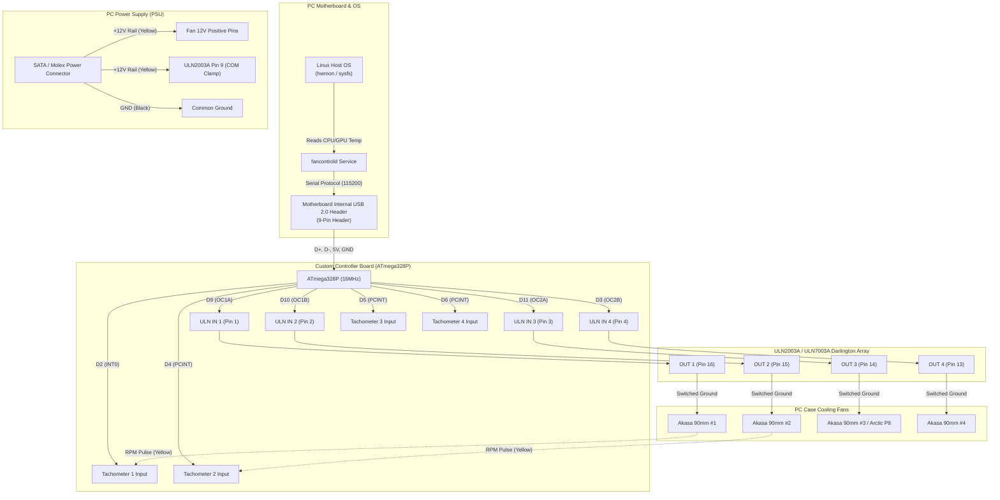

# Custom PC Fan Controller - Case Integration & Hardware Guide

This guide details how to build and mount the custom **ATmega328P + ULN2003A/ULN7003A** fan controller inside a desktop PC case and control it from Linux.

---

## 1. System Architecture



---

## 2. PC Case Connections

### A. Power Supply (Internal SATA / Molex)
Never power multiple 12V cooling fans from the motherboard 5V USB rail! Use an internal Molex (4-pin) or SATA power plug:
- **Yellow Wire**: `+12V DC` (Supplies power to all fans and `COM` Pin 9 of ULN).
- **Black Wires**: `GND` (Tie to ULN Pin 8 and ATmega328P Ground).
- **Red Wire**: `+5V DC` (Optional: can power ATmega328P VIN/5V, or let USB power the MCU).

### B. Motherboard Internal USB 2.0 Header (9-pin)
Most PC motherboards have 1 or 2 internal 9-pin USB 2.0 headers:
```
       Pin 1 (+5V)    [●] [●]  Pin 2 (+5V)
       Pin 3 (Data -) [●] [●]  Pin 4 (Data -)
       Pin 5 (Data +) [●] [●]  Pin 6 (Data +)
       Pin 7 (GND)    [●] [●]  Pin 8 (GND)
       Pin 9 (Key/NC) [ ] [●]  Pin 10 (NC / Shield)
                       Port 1   Port 2
```
To connect the ATmega328P (or Arduino Nano USB):
- Motherboard **Pin 1 (+5V)**  → USB VBUS (Red)
- Motherboard **Pin 3 (D-)**   → USB D- (White)
- Motherboard **Pin 5 (D+)**   → USB D+ (Green)
- Motherboard **Pin 7 (GND)**  → USB GND (Black)

---

## 3. ULN2003A / ULN7003A Pinout & Fan Wiring

```
                    ULN2003A / ULN7003A
                    ┌───────∪───────┐
  ATmega D9  ──> 1 ─┤ 1B        1C ├─ 16 ──> Fan 1 Negative (-)
  ATmega D10 ──> 2 ─┤ 2B        2C ├─ 15 ──> Fan 2 Negative (-)
  ATmega D11 ──> 3 ─┤ 3B        3C ├─ 14 ──> Fan 3 Negative (-)
  ATmega D3  ──> 4 ─┤ 4B        4C ├─ 13 ──> Fan 4 Negative (-)
                 5 ─┤ 5B        5C ├─ 12
                 6 ─┤ 6B        6C ├─ 11
                 7 ─┤ 7B        7C ├─ 10
  Common GND ──> 8 ─┤ GND      COM ├─ 9  ──> +12V Rail (CRITICAL)
                    └───────────────┘
```

> [!CAUTION]
> **Pin 9 (COM) must be connected to the +12V power rail!**
> Fans are inductive loads. When the Darlington transistors turn off, inductive flyback voltage can easily exceed 60V, which will destroy unprotected transistors. Pin 9 routes these spikes safely through the ULN's built-in clamp diodes back into the 12V rail.

### 3-Pin Fan Connector Pinout (Akasa / Arctic P8):
1. **Black (Pin 1 - GND)**: Connects to ULN Output (Pin 16, 15, 14, or 13).
2. **Red (Pin 2 - +12V)**: Connects directly to the PSU +12V rail (Yellow).
3. **Yellow (Pin 3 - Sense/Tach)**: Connects to ATmega tachometer pin (D2, D4, D5, D6) with a $10\text{k}\Omega$ pull-up resistor to 5V.

---

## 4. Hardware Watchdog & Fail-Safe

In an internal PC cooling setup, thermal safety is vital:
- The firmware contains an active **5-second heartbeat watchdog**.
- If the Linux host freezes, crashes, or the USB connection drops, the ATmega automatically sets all fans to **70% duty cycle (180/255)** after 5 seconds of silence.
- As soon as the Linux daemon resumes communication, smooth curve control automatically recovers.

---

## 5. Linux Installation & Systemd Service

1. **Install udev rule:**
   ```bash
   sudo cp daemon/99-fancontrol.rules /etc/udev/rules.d/
   sudo udevadm control --reload-rules && sudo udevadm trigger
   # Verifies device is now accessible at /dev/fancontrol
   ls -la /dev/fancontrol
   ```

2. **Build and install daemon:**
   ```bash
   cd daemon
   make
   sudo make install
   ```

3. **Start and enable systemd service:**
   ```bash
   sudo systemctl daemon-reload
   sudo systemctl enable --now fancontrol.service
   sudo systemctl status fancontrol.service
   ```
