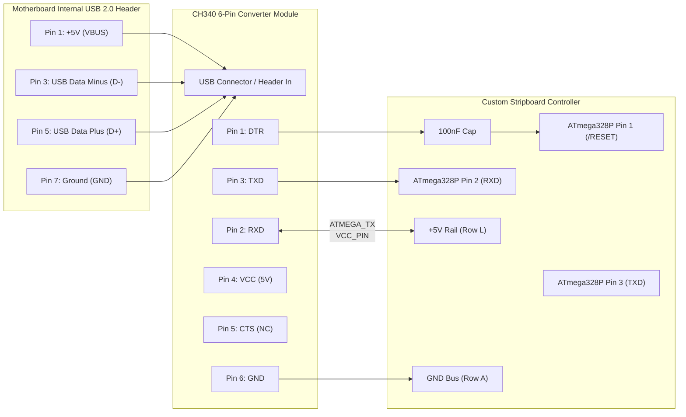

# PC Case Internal Wiring Guide
## Motherboard Internal USB Header + CH340 6-Pin Module + Fan Controller

This document details how to connect the **CH340 6-Pin USB-Serial module** between your motherboard's internal USB 2.0 9-pin header and the custom fan controller stripboard inside your PC chassis.

---

## 1. System Interconnect Diagram



---

## 2. Motherboard 9-Pin USB Header Pinout

Locate an internal 9-pin USB 2.0 header on your motherboard (usually labeled `JUSB1`, `USB_12`, or `F_USB` along the bottom edge):

```
       Pin 1 (+5V)    [●] [●]  Pin 2 (+5V)
       Pin 3 (Data -) [●] [●]  Pin 4 (Data -)
       Pin 5 (Data +) [●] [●]  Pin 6 (Data +)
       Pin 7 (GND)    [●] [●]  Pin 8 (GND)
   Pin 9 (Key/No pin) [ ] [●]  Pin 10 (NC / Shield)
                       Port 1   Port 2
```

Use a standard internal USB 2.0 extension or adapter cable to route **Port 1** (Pins 1, 3, 5, 7) directly to the CH340 module's USB input:
- **Red Wire (+5V):** Motherboard Pin 1 $\rightarrow$ CH340 USB VBUS (+5V)
- **White Wire (D-):** Motherboard Pin 3 $\rightarrow$ CH340 USB D-
- **Green Wire (D+):** Motherboard Pin 5 $\rightarrow$ CH340 USB D+
- **Black Wire (GND):** Motherboard Pin 7 $\rightarrow$ CH340 USB Ground

---

## 3. CH340 6-Pin Header to Stripboard Header Mapping

The CH340 module's 6 pins plug into the 6-pin socket on your stripboard:

| CH340 Pin | Function | Connects To on Stripboard | Purpose |
| :---: | :---: | :--- | :--- |
| **DTR** | Data Terminal Ready | In-line $100\text{nF}$ capacitor $\rightarrow$ ATmega Pin 1 (/RESET) | Auto-reset on code upload / connection |
| **RXD** | Serial Receive | ATmega **Pin 3 (PD1 / TXD)** | Receives fan telemetry & RPM from MCU |
| **TXD** | Serial Transmit | ATmega **Pin 2 (PD0 / RXD)** | Sends PWM commands from Linux to MCU |
| **VCC** | Power Output (5V) | Stripboard **Row L (+5V Rail)** | Supplies 5V to ATmega logic |
| **CTS** | Clear To Send | *No Connection (NC)* | Unused in 2-wire serial |
| **GND** | Ground | Stripboard **Row A (GND Bus)** | Common signal reference |

> [!IMPORTANT]
> **Voltage Jumper on CH340:**
> Ensure the small plastic jumper on the CH340 module is set to **5V** (not 3.3V) so that its output logic levels match the 5V ATmega328P running at 16 MHz.

---

## 4. PSU 12V Power Connection (Molex / SATA)

For the fans and the ULN2003A driver, connect power from the PC power supply:
- **Yellow Wire (+12V):** Connects to the stripboard 2-pin screw terminal (+12V side), powering:
  - All Fan positive pins (Pin 2).
  - **ULN2003A Pin 9 (`COM`)** for inductive flyback protection.
- **Black Wire (GND):** Connects to the stripboard 2-pin screw terminal (GND side), tying PC PSU ground directly to the common ground bus.

---

## 5. Linux Driver / Tool Integration

Because the CH340 is an industry-standard USB-UART bridge, it is supported out-of-the-box by the Linux kernel module `ch341.ko`:
- **Plug and Play:** As soon as your PC boots, Linux creates `/dev/ttyUSB0`.
- **Automatic Symlink:** Our provided udev rule (`daemon/99-fancontrol.rules`) creates a persistent symlink at `/dev/fancontrol`.
- **Zero-Friction Flashing:** `make flash PORT=/dev/fancontrol` in the `firmware/` directory flashes the ATmega328P immediately over USB.
- **Monitoring & Daemon:** The Linux daemon (`fancontrold`) runs in the background, continuously managing fan speeds according to CPU and GPU temperatures.
